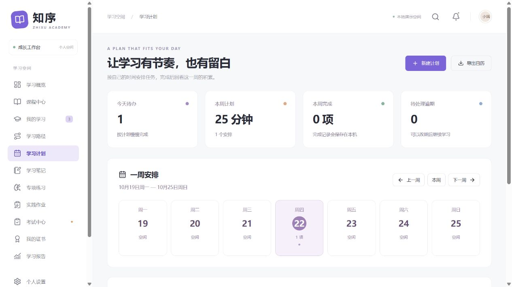

# 知序学习 · TrainingExam

基于 **React 19 + TypeScript + Vite** 的中文培训、学习与考试系统。以浅紫色成长工作台为视觉主题，支持桌面和手机访问。

这是可独立运行的前端应用：课程、讲师和初始学习记录为示例数据；个人资料、进度、笔记、练习和作业保存在当前浏览器。无需账号或后端即可体验学习、练习、测评和复盘流程。



[学习概览](docs/screenshots/overview-desktop.jpg) · [手机端预览](docs/screenshots/planner-mobile.jpg) · [验收记录](docs/QA.md) · [开发阶段](docs/MILESTONES.md)

## 快速开始

建议使用 **Node.js 24 LTS** 与 npm 11。

```bash
git clone https://github.com/davidZhang666-bin/TrainingExam.git
cd TrainingExam
git switch codex/training-learning-exams
npm ci
npm run dev
```

打开终端显示的本地地址，默认是 `http://localhost:5173`。

```bash
npm run build      # TypeScript 检查与生产构建，输出 dist/
npm run preview    # 预览生产构建
```

`dist/` 可部署至静态站点服务。使用 hash 导航，无需服务器配置路由回退。所有运行资源均随构建发布，不依赖在线字体或图片服务。

## 功能

| 模块     | 已实现能力                                                                                 |
| -------- | ------------------------------------------------------------------------------------------ |
| 学习概览 | 真实记录统计、继续学习、推荐课程、学习足迹、每周目标、下一步建议                           |
| 课程中心 | 4 门课程、16 个图文章节、关键词搜索、分类、排序、收藏、课程详情与报名                      |
| 我的学习 | 课程状态筛选、章节导航、按顺序完成、幂等进度记录、章节笔记自动保存                         |
| 学习路径 | 3 条成长路线、加入与退出、已有进度计入、章节和关联测评共同决定阶段解锁                     |
| 学习计划 | 周日历、指定日期建任务、编辑与完成、冲突校验、逾期筛选、ICS 日历导出                       |
| 学习笔记 | 独立笔记、课程关联、标签、搜索筛选和排序、置顶归档、Markdown 导出、章节笔记收集去重        |
| 专项练习 | 26 道单选、多选和判断题、课程题型筛选、随机练习、草稿恢复、逐题解析、历史记录与间隔复习    |
| 实践作业 | 4 个工作情境、实时草稿、提交前自查、不可覆盖的内容版本、版本反思、继续改进和 Markdown 导出 |
| 考试中心 | 3 场测评、15 道带解析的单选题、须知确认、答题卡、草稿恢复、持续计时、手动及超时交卷        |
| 学习复盘 | 自动评分、及格判断、逐题解析、历次成绩、按最近一次考试作答更新错题集                       |
| 我的证书 | 通过测评获得证书、预览、安全转义的 SVG 图片下载                                            |
| 学习报告 | 时间范围筛选、学习投入、连续天数、分类时长、课程进度、历史最佳成绩                         |
| 个人设置 | 资料编辑、目标设置、提醒偏好、恢复示例数据前的输入确认                                     |
| 数据管理 | JSON 备份与校验预览恢复，覆盖新增模块、草稿和反思；带中文 BOM 和公式防护的 CSV 报告        |
| 通用体验 | 全局搜索（Ctrl / ⌘ K）、学习通知、已读状态、键盘焦点管理、手机导航                         |

建议先从「课程中心」加入课程，再用「学习计划」安排一次学习。在「学习笔记」整理收获，选择「专项练习」巩固知识，并在「实践作业」保存一次应用与反思。考试达到 80 分后可下载演示证书。

多选题需要选中全部正确选项且没有错误选项才得分；漏答按错误计入练习结果和复习安排。连续答对后的复习间隔依次为 1 天、3 天，此后加倍，最长 30 天；答错或漏答重置为 1 天。此规则用于个人学习安排。

## 测试与检查

```bash
npm test                           # 领域逻辑、组件交互、状态和备份测试
npm run build                      # TypeScript 严格检查和生产构建
npm run format:check               # Prettier 格式检查
npm run verify:project             # 自有代码文件、语法、文档和五条待办检查
npm run verify:history             # 至少 30 次非空 Conventional Commits 提交
npm audit                          # 依赖漏洞检查
```

浏览器流程测试可在安装测试浏览器后执行：

```bash
npx playwright install chromium
npm run test:e2e
```

测试失败时可在 `playwright-report/` 查看报告。GitHub Actions 配置了格式、单元和组件测试、构建、项目及历史检查、Playwright 流程测试。本次实际执行范围与历史结果分别列在 [验收记录](docs/QA.md)。

## 目录

```text
src/
  components/        通用弹窗、课程卡片、答题器、报告图表等
  pages/             概览、课程、学习、路径、计划、笔记、练习、作业、考试等页面
  features/
    planner/         任务校验、日历、冲突检测与 ICS
    notebook/        笔记校验、筛选、编辑与导出
    practice/        题库、会话、评分、复习调度与统计
    paths/           路线定义、阶段完成和解锁计算
    assignments/     情境任务、自查、版本与反思
  workspace/         日期与输入工具、共享界面及样式
  domain.ts          领域类型、完整课程与考试题库
  store.tsx          React 状态管理与学习操作
  persistence.ts     本地数据校验、修复、加载
  assessment.ts      考试评分与交卷快照
  backup.ts          备份格式与 CSV 报告
  downloads.ts       文件下载与证书 SVG
  notifications.ts   根据学习记录生成提醒
e2e/                 浏览器流程测试
scripts/             项目和提交历史校验
docs/                验收、开发阶段与截图
.github/workflows/   持续集成
```

## 数据与使用边界

- 使用本地存储键 `zhixu-learning-v1`；清除站点数据会删除记录，建议先在个人设置中导出备份。不同源、端口和浏览器各自保存数据。
- 兼容旧版 v1 备份；缺失的新模块字段初始化为空。练习复习日程从有效历史重算，重复交卷不会产生第二条记录。
- 损坏或不支持的本地记录会回退到初始数据，原始字符串尽可能保存到 `zhixu-learning-v1-recovery`。部分字段异常时仅修复异常字段。
- 恢复备份会覆盖当前浏览器的工作区，页面会先展示记录数量并要求确认。导入上限为 2 MB；大量长笔记或作业可能超出此限制。
- 学习时长由示例初始记录及首次完成章节的标称分钟数累计，不代表后台监测的实际在线时长；计划时长仅用于个人安排。
- 考试倒计时采用绝对截止时间，切换页面、刷新或关闭页面不会暂停。应用运行时到期交卷；浏览器关闭或休眠时，下一次打开应用会处理过期草稿。
- 实践作业只记录个人内容、自查和反思，尚未接入讲师评分；它不会产生考试成绩或证书。
- 此版本以单一浏览器标签页使用为准；本地数据可被使用者修改。正式考试需要服务器评分、身份校验和权限控制。
- 证书是演示学习证明，不是专业资格认证。数据备份不加密，请自行妥善保存。
- 页面中的讲师评分、累计学习人数为固定演示信息；个人统计来自本地记录。

## 提交规范

保留初始 30 次非空提交，后续维护按实际功能、修复、测试和文档增量继续提交，不重写历史或使用空提交。提交消息采用 Conventional Commits：

```text
feat(planner): add weekly study scheduling
fix(practice): derive progress from answered questions
test: verify workspace backup and reload recovery
docs: update setup and development milestones
```

允许类型：`feat`、`fix`、`docs`、`style`、`refactor`、`perf`、`test`、`build`、`ci`、`chore`。可使用作用域，如 `feat(exam): add answer review`。`verify:history` 检查最低数量、非空变更和消息格式；实际业务价值仍需代码审阅。

恰好 5 条有意保留的未完成功能、计划和涉及代码见 [TODO.md](TODO.md)。
